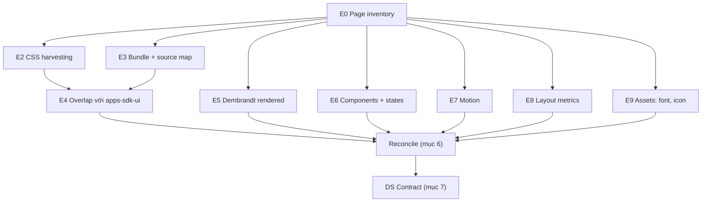

# DS Setup Spec (dành cho AI agent)

## 0. Nhiệm vụ

**Mục tiêu:** dựng **DS Contract** + **repo prototype sẵn sàng dựng màn hình**. Giao diện phải khớp tối đa với OpenAI Platform (`https://platform.openai.com`), và mọi giá trị đều đi qua tokens.

**Phạm vi:** chỉ UI, motion, behavior. Dữ liệu là mock, không có backend thật, không có tính năng thật.

**Đầu ra:**
1. `docs/design-system/`: DS Contract (tokens, components, motion, layout, voice, anti-slop, DESIGN.md, provenance)
2. `src/tokens/`: tokens sinh tự động (CSS vars light/dark, Tailwind v4 `@theme`, TS cho motion)
3. `src/components/`: thư viện component + skin chat, đủ states, có Storybook
4. Hạ tầng prototype: app shell, routing, mocks, thanh debug state, lint/guardrails, pipeline kiểm định
5. `ds-extraction/`: toàn bộ dữ liệu thô, phân tích, ảnh tham chiếu (tái chạy được)

**Cách làm việc:** dừng ở mỗi checkpoint `🛑` để người dùng duyệt. Giá trị nào không có bằng chứng thì gắn `unverified`, không tự đoán.

---

## 1. Đầu vào

| Biến | Giá trị |
|---|---|
| `PLATFORM_ORIGIN` | `https://platform.openai.com` |
| `ENTRY_URL` | `https://platform.openai.com/settings/proj_DGeYnYWffW39RdZS0aXrcFWV` |
| `REF_DS` | `@openai/apps-sdk-ui` (repo `openai/apps-sdk-ui`, Storybook `https://openai.github.io/apps-sdk-ui/`) |
| `REF_FIGMA` | Figma "Apps in ChatGPT • Components & Templates" (người dùng cung cấp link khi cần) |
| Phiên đăng nhập | Người dùng tự đăng nhập trong Chrome profile riêng (mục 3.2) |
| Quyết định chờ người dùng | D1–D5 (mục 15) |

---

## 2. Toolchain

| Công cụ | Vai trò | Ghi chú |
|---|---|---|
| **Node 24 LTS** (≥ 24.22.1) | Runtime chung | REA không chạy trên Node 25 (máy hiện có 25.8.2) → ghim bằng `fnm` + `.nvmrc` |
| **REA** (`rea-agents`) | Trinh sát trang, thu thập CSS/resources, **phân tích bundle + source map**, trace code motion, capture theo kịch bản | MCP + CLI. Đọc skill `reverse-engineer-anything` (cài kèm) để biết tham số chính xác |
| **Dembrandt** | Trích tokens từ computed styles hàng loạt (crawl, dark, mobile), xuất DTCG / Tailwind / DESIGN.md; **kiểm định token** trên prototype | CLI + MCP (`npx -y dembrandt mcp`) |
| **Chrome DevTools MCP** | `get_css_styles`, `evaluate_script`, `hover`, `click`, `take_screenshot`, `take_snapshot`, `emulate`, `resize_page`, performance trace | Kết nối vào Chrome của người dùng (`--browserUrl=http://127.0.0.1:9222`) |
| **`@openai/apps-sdk-ui`** | DS mã nguồn mở của OpenAI: 3 lớp CSS vars (primitive / semantic / components), 28 component Radix, motion tokens, hooks | Tham chiếu tên + giá trị, và có thể dùng làm dependency (D1) |
| **assistant-ui** | Khung hành vi chat (Thread, Message, Composer, ActionBar, BranchPicker, ThreadList…) + `LocalRuntime` mock | Docs MCP: `https://www.assistant-ui.com/mcp` |
| Radix (`radix-ui`) | Khung hành vi cho các component còn thiếu | |
| Motion (`motion`) | Animation khai báo | `import { motion } from "motion/react"` |
| Style Dictionary v4 | Build `tokens.json` (DTCG) → CSS / TS | |
| `@projectwallace/css-analyzer`, `postcss`, `culori` | Thống kê CSS, parse, gom màu theo ΔE (OKLab / CIEDE2000) | |
| Storybook, Playwright, `pixelmatch` | Catalog component, chụp ảnh, so sánh pixel | |
| Figma MCP (đã có) | Đọc wireframe / annotation người dùng vẽ | Chỉ đọc |

---

## 3. Setup môi trường

### 3.1 Node + công cụ
```bash
brew install fnm && fnm install 24 && fnm use 24 && node -v   # ≥ 24.22.1
npx rea-agents@latest setup            # chọn "antigravity", rồi restart agent
npx dembrandt install-browser          # tải Chromium cho Dembrandt
```
MCP cần có: `rea`, `chrome-devtools` (thêm `--browserUrl=http://127.0.0.1:9222`), `dembrandt` (`npx -y dembrandt mcp`), `assistant-ui` (HTTP `https://www.assistant-ui.com/mcp`), `figma`.

### 3.2 Chrome dùng chung (REA + Chrome DevTools MCP)
```bash
"/Applications/Google Chrome.app/Contents/MacOS/Google Chrome" \
  --remote-debugging-port=9222 --user-data-dir="$HOME/.chrome-ds"
```
🛑 Người dùng đăng nhập `PLATFORM_ORIGIN` trong cửa sổ này và mở sẵn `ENTRY_URL`.

### 3.3 Phiên đăng nhập cho Dembrandt
```bash
npx dembrandt "$ENTRY_URL" --login --save-storage-state .secrets/platform.state.json
# Cửa sổ trình duyệt mở ra → người dùng đăng nhập → nhấn Enter trong terminal
```
Các lần chạy sau dùng `--cookie-file .secrets/platform.state.json`.

---

## 4. Scaffold repo

```bash
npm create vite@latest prototype -- --template react-ts
cd prototype && echo "24" > .nvmrc
npm i tailwindcss @tailwindcss/vite @openai/apps-sdk-ui radix-ui motion @assistant-ui/react
npm i -D style-dictionary @projectwallace/css-analyzer postcss postcss-value-parser culori \
        @playwright/test pixelmatch pngjs eslint eslint-plugin-better-tailwindcss stylelint
npx storybook@latest init
```
Thêm component chat của assistant-ui qua CLI/registry (`npx assistant-ui@latest init` hoặc `add`, tra docs MCP để biết lệnh hiện hành với Vite).

```
prototype/
├── AGENTS.md
├── docs/
│   ├── product/                       ← (giai đoạn spec nghiệp vụ, ngoài phạm vi spec này)
│   └── design-system/
│       ├── tokens.json  DESIGN.md  components.md  motion.md
│       ├── layout-rules.md  voice.md  anti-slop.md  provenance.md  decisions.md
├── ds-extraction/
│   ├── pages.json                     ← inventory trang (E0)
│   ├── raw/{css,bundles,dembrandt,computed,motion,rea}/
│   ├── captures/{pages,components,motion}/
│   ├── analysis/{overlap.md,colors.md,type.md,spacing.md,radius-shadow.md,conflicts.md}
│   └── scripts/                       ← script parse/merge/cluster (tái chạy được)
├── src/
│   ├── tokens/{tokens.css,tokens.dark.css,theme.css,motion.ts}
│   ├── styles/app.css                 ← entry: tailwind + apps-sdk-ui + tokens
│   ├── components/{ds,patterns,chat}/
│   ├── shell/                         ← app shell (sidebar, topbar, page frame)
│   ├── mocks/{data,chat-scenarios.ts,runtime.ts}
│   ├── dev/StateToolbar.tsx           ← thanh debug state (chỉ ở môi trường dev)
│   ├── screens/  specimen/
├── tests/visual/
├── .secrets/                          ← gitignore
└── style-dictionary.config.mjs
```

Entry CSS:
```css
@import "tailwindcss";
@import "@openai/apps-sdk-ui/css";          /* tuỳ D1 */
@source "../../node_modules/@openai/apps-sdk-ui";
@import "../tokens/theme.css";              /* @theme của dự án, reset palette mặc định */
@import "../tokens/tokens.css";
@import "../tokens/tokens.dark.css";
```
`.gitignore`: `.secrets/`, `ds-extraction/raw/`, `output/`.

---

## 5. Pipeline trích xuất



### E0: Page inventory
- REA `list_browser_targets` → `inspect_web_page` trên `ENTRY_URL` (DOM, accessibility, resources, scripts).
- REA `analyze_web_bundle` → **route candidates**. Kết hợp với link trong sidebar/nav (DOM) để có danh sách route.
- Phân loại mỗi route theo **template**: `settings-form`, `table-list`, `detail`, `dashboard-chart`, `playground-chat`, `empty`, `modal-heavy`, `docs`.
- Ghi `ds-extraction/pages.json`: `{ url, template, priority, hasDarkMode, notes }`. Chọn 2–3 trang mỗi template (priority 1).
- 🛑 **CP1:** duyệt inventory + danh sách trang priority 1.

### E1: Biến thể capture
Ma trận mặc định cho trang priority 1:
- viewport: 1440×900, 1280×800, 768×1024, 390×844
- color scheme: light, dark (nếu có)
- `reduced_motion`: `no-preference` (riêng E7 chụp thêm `reduce`)

Cách chụp:
- Ảnh: REA `capture_browser_scenario` (mode `connect`) với `capture.at_end: ["screenshot","dom","accessibility"]`, đặt `environment.reduced_motion: "no-preference"` (mặc định của REA là `reduce`).
- Trước khi chụp, chạy `evaluate_script` thay API key, email, số tiền bằng placeholder để ảnh commit được.

### E2: Thu thập CSS (ý định khai báo)
1. Lấy URL stylesheet từ resources của E0 trên mọi trang priority 1. Tải về `raw/css/` (gửi kèm cookie từ storage state nếu cần), hoặc dùng `capture.network.response_body: true` của REA với `limits.max_network_body_bytes` nâng lên (ví dụ 8 MiB).
2. Ghi lại `<style>` inline và `adoptedStyleSheets` bằng `evaluate_script` (lấy `cssRules` → `cssText`).
3. Parse bằng postcss → `raw/css-index.json`:
   - mọi custom property `--*`, kèm **scope selector** (`:root`, `[data-theme=dark]`, `.dark`, `@media (prefers-color-scheme)`, scope cấp component)
   - `@media` → breakpoints
   - `@font-face` → family, weight, style, URL file
   - `@keyframes` + mọi khai báo `transition`/`animation` kèm selector
   - `z-index`, `box-shadow`, `border-radius` theo selector
4. Chạy `@projectwallace/css-analyzer` → `analysis/css-stats.json` (unique colors, font-sizes, spacing, radius, shadows, specificity).

### E3: Bundle + source map (ý định ở cấp code)
1. REA `inspect_web_page` (bật thu script sources) → `export_web_scripts` → `raw/bundles/`.
2. REA `analyze_web_bundle` (bật lấy source map). Nếu có source map:
   - Lập **cây module gốc**: tìm thư mục DS nội bộ (ví dụ `design-system/`, `ui/`, `tokens/`, `theme/`), tên package, tên component.
   - Trích **file token/theme gốc** (object palette, scale, breakpoints, motion presets) → `raw/rea/tokens-source/`.
   - Lập **inventory component theo tên gốc** → dùng làm tên component chuẩn (E6).
3. Không có source map: tìm theo pattern trong bundle (`cubic-bezier(`, `stiffness`, `damping`, `duration:`, tên CSS module, chuỗi `var(--`) → `raw/rea/patterns.json`.
4. Phát hiện stack styling (CSS modules / Tailwind / CSS-in-JS) và thư viện motion → `analysis/stack.md`.

### E4: Đối chiếu với apps-sdk-ui
1. Lấy danh sách biến từ `apps-sdk-ui/src/styles/variables-{primitive,semantic,components}.css`.
2. So với `css-index.json`:
   - % **trùng tên**
   - % **trùng tên và trùng giá trị**
   - các biến chỉ có ở platform / chỉ có ở apps-sdk-ui
3. So component: apps-sdk-ui (28) với inventory E3/E6, đánh dấu khớp / khác / thiếu.
4. → `analysis/overlap.md` + đề xuất **D1** (mục 15).

### E5: Trích xuất từ giá trị render (Dembrandt)
Chạy cho mọi trang priority 1 và một lần crawl:
```bash
COMMON="--cookie-file .secrets/platform.state.json --dtcg --design-md --tailwind --save-output --color-format oklch --wcag --slow"
npx dembrandt "<URL>" $COMMON                         # desktop light
npx dembrandt "<URL>" $COMMON --dark-mode             # desktop dark
npx dembrandt "<URL>" $COMMON --mobile                # mobile 390x844
npx dembrandt "$ENTRY_URL" $COMMON --crawl 15         # gộp nhiều trang, có cross-page confidence
```
Chuyển `output/<domain>/` về `raw/dembrandt/<page>/<variant>/`. Viết script merge → `analysis/rendered-merged.json`, gồm giá trị, số lần xuất hiện, trang, vai trò (màu theo vai trò, type groups, spacing scale, radius, shadows, motion, breakpoints).

### E6: Components, anatomy, states
- Danh mục mục tiêu: app shell (sidebar, sidebar item, section label, project/org switcher, topbar, user menu), page header, section, settings row (label + mô tả + control), button (mọi variant), icon button, input, textarea, select, combobox, checkbox, radio, switch, segmented control, tabs, table (header, row, cell, sort, empty), pagination, badge/status, tooltip, menu/dropdown, popover, dialog, drawer/sheet, toast, alert/banner, code block, copy field, date picker, skeleton, empty state, chart container, và các thành phần chat (thread, message user/assistant, composer, action bar, tool card, reasoning).
- Với từng component, dùng Chrome DevTools MCP:
  - `take_snapshot` → chọn phần tử → `get_css_styles` (cascade + biến đang tham chiếu)
  - **states:** `hover`; focus (Tab hoặc `el.focus()`); active (`evaluate_script` dispatch `pointerdown`); disabled/loading/error (tìm trên trang hoặc đọc selector `:disabled`, `[aria-invalid]`, `[data-state]` từ `css-index.json`); open (`click`)
  - crop ảnh từng state → `captures/components/<name>/<variant>-<state>@<vp>.png`
- Ghi anatomy **theo tên biến CSS gốc** nếu có (từ `get_css_styles`), nếu không thì theo giá trị.

### E7: Motion
1. **Tĩnh:** keyframes + transitions (E2), motion presets (E3).
2. **Runtime (CSS / WAAPI):** gài bộ ghi rồi mới thao tác:
```js
() => { window.__motionLog = []; const seen = new WeakSet();
  const tick = () => { for (const a of document.getAnimations()) { if (seen.has(a)) continue; seen.add(a);
    const t = a.effect?.getTiming?.() || {}; const el = a.effect?.target;
    window.__motionLog.push({ at: Math.round(performance.now()), type: a.constructor.name,
      name: a.animationName || a.transitionProperty || a.id || '',
      target: el ? el.tagName.toLowerCase() + (el.className && typeof el.className === 'string' ? '.' + el.className.split(' ')[0] : '') : null,
      duration: t.duration, delay: t.delay, easing: t.easing, fill: t.fill, keyframes: a.effect?.getKeyframes?.() }); }
    window.__motionRaf = requestAnimationFrame(tick); };
  tick(); return 'armed'; }
```
3. **Animation chạy bằng JS (rAF / spring):**
   - REA `inspect_web_event_listeners` trên phần tử kích hoạt → `observe_web_execution` khi thao tác → `trace_web_source_location` → đọc tham số spring/duration trong source.
   - Bổ sung bằng performance trace và chụp chuỗi frame (`captures/motion/<interaction>/`).
4. Bộ tương tác cần đo: mở/đóng dialog, drawer, menu, popover, tooltip; chuyển tab; hover row/button; toast vào/ra; expand/collapse sidebar; chuyển trang; skeleton → content; chat (tin nhắn xuất hiện, nhịp stream chữ, thinking indicator, auto-scroll, tool card mở ra).
5. Chụp lại khi `reduced_motion: reduce` để ghi lại hành vi thay thế.
6. → `raw/motion/*.json` + bảng pattern.

### E8: Layout metrics
Dùng `evaluate_script` đo `getBoundingClientRect` + computed style của các landmark (`nav`, `header`, `main`, container nội dung, sidebar) ở mỗi viewport:
- chiều rộng sidebar (mở/thu gọn), chiều cao topbar
- max-width nội dung, padding trang, gutter
- khoảng cách giữa các section, chiều cao hàng bảng, khoảng cách giữa các field
- breakpoint mà sidebar chuyển thành drawer

→ `analysis/layout.json`

### E9: Assets
- **Font:** family, weight, file URL (E2 `@font-face`) + `document.fonts` → `analysis/fonts.md`. Lựa chọn dùng font nào là quyết định **D3**.
- **Icon:** thu toàn bộ inline SVG và sprite (`<symbol>`), loại trùng theo hash của path → `raw/icons/`. So với các bộ icon phổ biến để nhận diện thư viện. Ghi kích thước gốc, stroke width, viewBox → `analysis/icons.md` + quyết định **D4**.

🛑 **CP2:** trình bày bản tổng hợp: stack, overlap %, palette, type, spacing, radius/shadow, motion, layout, font/icon + đề xuất D1–D4.

---

## 6. Quy tắc hợp nhất (reconcile)

**Ưu tiên nguồn cho giá trị:**
1. Biến CSS platform khai báo (E2) / token gốc trong source (E3)
2. Giá trị render lặp lại (E5/E6) với confidence cao
3. apps-sdk-ui (E4), chỉ khi platform không có dữ liệu cho token đó

**Ưu tiên nguồn cho tên token:**
1. Tên biến gốc của platform
2. Tên trong apps-sdk-ui
3. Tên semantic tự đặt theo quy ước `category.role.variant.state`

**Luật:**
- Gom màu theo ΔE (CIEDE2000) < 1.5. Gom spacing/radius về thang có bước rõ ràng. Giá trị xuất hiện < 3 lần trên < 2 trang → outlier, không thành token.
- **Confidence** = f(số nguồn đồng thuận, số lần xuất hiện, số trang): `high` (≥ 2 nguồn đồng thuận), `medium`, `low` (một nguồn).
- Nguồn mâu thuẫn → ghi vào `analysis/conflicts.md` (giá trị từng nguồn + bằng chứng + đề xuất). Không tự chọn lặng lẽ.
- Màu luôn có 2 lớp: primitive (palette) → semantic (vai trò). Component tokens chỉ tham chiếu semantic.
- Dark mode: mỗi semantic token phải có giá trị dark (nếu D2 = có).

---

## 7. DS Contract

### 7.1 `tokens.json` (DTCG)
```json
{
  "color": {
    "primitive": { "gray": { "100": { "$type": "color", "$value": "oklch(0.97 0 0)",
      "$extensions": { "provenance": { "sources": ["css:--gray-100", "dembrandt", "apps-sdk-ui:--gray-100"],
        "count": 318, "pages": 9, "confidence": "high" } } } } },
    "semantic": {
      "bg": { "primary": { "$type": "color", "$value": "{color.primitive.gray.0}",
        "$extensions": { "mode": { "dark": "{color.primitive.gray.1000}" } } } } }
  },
  "font": { "family": {}, "size": {}, "lineHeight": {}, "weight": {}, "tracking": {} },
  "space": {}, "size": { "control": {} }, "radius": {}, "shadow": {}, "border": {},
  "breakpoint": {}, "z": {}, "opacity": {},
  "motion": {
    "duration": { "basic": { "$type": "duration", "$value": "150ms" } },
    "easing": { "enter": { "$type": "cubicBezier", "$value": [0.19, 1, 0.22, 1] } },
    "spring": {}
  },
  "layout": { "sidebar": {}, "topbar": {}, "content": {}, "page": {} },
  "chat": { "message": {}, "composer": {}, "bubble": {} }
}
```
(Dùng đúng phiên bản cú pháp DTCG mà Style Dictionary v4 hỗ trợ; giá trị dark mode đặt theo cách mà config build đọc được.)

### 7.2 Các file khác
| File | Nội dung bắt buộc |
|---|---|
| `DESIGN.md` | Bản tóm tắt cho AI (gộp từ output `--design-md` của Dembrandt rồi biên tập lại): nguyên tắc thị giác, token hay dùng, quy tắc cấm. **AI đọc file này trước khi dựng màn hình** |
| `components.md` | Mỗi component: nguồn (`platform-observed` / `apps-sdk-ui` / `radix+tokens` / `assistant-ui+tokens`), anatomy theo tên token, variants, sizes, states, motion, a11y/keyboard, ảnh tham chiếu, ghi chú cấm |
| `motion.md` | Thang duration/easing/spring theo vai trò; bảng pattern (Trigger, Phần tử, Thuộc tính, Từ → Đến, Duration, Easing, Delay/Stagger, Reduced-motion, Nguồn); choreography |
| `layout-rules.md` | App shell theo breakpoint, page frame, settings layout, table/list, mật độ, quy tắc responsive |
| `voice.md` | Quy luật microcopy (case, động từ, độ dài, lỗi, empty), chuyển sang tiếng Việt |
| `anti-slop.md` | Những điều platform **không** làm (rút ra từ dữ liệu) + chatbot slop (màn hình chào có ✨, suggestion chip có icon, composer `rounded-3xl`, tool call dạng pill, vòng % context…) |
| `provenance.md` | Ngày chạy, phiên bản công cụ, danh sách trang, lệnh đã chạy |
| `decisions.md` | Kết quả D1–D5 |

---

## 8. Build tokens ra code

- `style-dictionary.config.mjs`: `tokens.json` →
  - `src/tokens/tokens.css`: `:root { --… }`
  - `src/tokens/tokens.dark.css`: `[data-theme="dark"] { --… }` + `@media (prefers-color-scheme: dark)` (nếu D2)
  - `src/tokens/theme.css`: Tailwind v4 `@theme` với **reset**: `--color-*: initial; --spacing-*: initial; --radius-*: initial; --shadow-*: initial; --font-*: initial; --text-*: initial;` rồi map lại sang biến của dự án
  - `src/tokens/motion.ts`: export duration (ms), easing (mảng bezier), spring cho Motion
- **Triển khai D1:**
  - **D1 = A** (overlap cao): giữ `@openai/apps-sdk-ui/css` làm nền. `tokens.css` chỉ chứa phần ghi đè và mở rộng. Dùng component apps-sdk-ui khi khớp.
  - **D1 = B** (overlap thấp): không import CSS của apps-sdk-ui. Tokens của dự án là nguồn duy nhất. Component tự dựng trên Radix, chỉ tham khảo apps-sdk-ui về cấu trúc.
- Script: `npm run tokens:build`, `tokens:watch`.

---

## 9. Thư viện component

**Thứ tự dựng:**
1. Primitives: Text/Heading, Icon, Button, IconButton, Input, Textarea, Checkbox, Radio, Switch, Select, Badge, Tooltip, Spinner, Skeleton
2. Composite: Menu, Popover, Dialog, Drawer, Tabs, SegmentedControl, Table, Pagination, Toast, Alert, CodeBlock, CopyField, DatePicker, EmptyState
3. Patterns: AppShell (Sidebar, SidebarItem, Topbar, ProjectSwitcher), PageHeader, Section, SettingsRow, FilterBar, DataList
4. Chat: xem mục 10

**DoD cho mỗi component:**
- [ ] Chỉ dùng tokens (lint pass); motion chỉ dùng `motion.ts`
- [ ] Đủ variants × sizes × states như `components.md`; mỗi tổ hợp có story trong Storybook
- [ ] Keyboard + focus-visible + ARIA đúng (Radix lo phần hành vi)
- [ ] Light/dark (nếu D2)
- [ ] **Visual diff** với ảnh tham chiếu E6 ở cùng viewport: pixelmatch ≤ ngưỡng thống nhất tại CP3 (gợi ý ≤ 2% pixel lệch trên vùng crop)

---

## 10. Chat layer (assistant-ui)

- Dùng primitives: `ThreadPrimitive`, `MessagePrimitive`, `ComposerPrimitive`, `ActionBarPrimitive`, `BranchPickerPrimitive`, `ThreadListPrimitive`, Attachment, Suggestion, Chain-of-thought, Error. **Skin 100% bằng tokens**, không giữ style mặc định.
- Tận dụng của apps-sdk-ui (nếu D1 = A): `Markdown`, `CodeBlock`, `ShimmerText`, `LoadingDots`, `useCharactersPerSecond`, `useAutoGrowTextarea`, `useAnimatedScrollTo`.
- **Mock runtime** (`src/mocks/runtime.ts`): `useLocalRuntime(MockAdapter)`, trong đó `MockAdapter.run` là `async *run`. Mỗi lần yield trả **toàn bộ** content (không yield phần chênh lệch), không yield một part rỗng ở cuối.
- **Kịch bản** (`src/mocks/chat-scenarios.ts`): trả lời ngắn; trả lời dài có markdown/bảng/code; reasoning; tool call → tool card (running / done / error / cần duyệt / bị từ chối); lỗi giữa stream; người dùng dừng; stream chậm; mất kết nối; hết quota; hội thoại rất dài; có attachment; sửa tin nhắn + rẽ nhánh.
- Nhịp stream mặc định lấy theo số đo ở E7.

---

## 11. Hạ tầng prototype

- **App shell + routing** (React Router), các route trống theo inventory sản phẩm (danh sách màn hình lấy từ spec nghiệp vụ, giai đoạn sau).
- **Mocks:** `src/mocks/data/*` có kiểu TypeScript; giả lập độ trễ.
- **Thanh debug state** (`src/dev/StateToolbar.tsx`, chỉ bật ở dev/preview): chuyển Default / Loading / Empty / Error / No-permission / Long-content cho màn hình hiện tại; chọn kịch bản chat; bật/tắt dark mode và reduced-motion.
- **Trang specimen** (`/specimen`): toàn bộ tokens, components, motion demo, app shell mẫu, khung chat mẫu.
- **Deploy preview** (Netlify/Vercel), làm sau CP4.

---

## 12. Guardrails

### 12.1 `AGENTS.md` (tóm tắt nội dung bắt buộc)
- Đọc `docs/design-system/DESIGN.md` + `components.md` trước khi dựng UI.
- Chỉ dùng component trong `src/components/**` và token trong `src/tokens/**`. Cấm hex/rgb/oklch literal, px lẻ, arbitrary value Tailwind, inline style (trừ giá trị động do Motion tính).
- Thiếu component hoặc token: dừng lại và đề xuất, không tự chế.
- Motion chỉ dùng `motion.ts`; tôn trọng reduced-motion.
- Trước khi code màn hình: trình bày component tree. Sau khi code: lint + chụp 3 viewport + chạy `ds:verify`.

### 12.2 Lint
- ESLint + `eslint-plugin-better-tailwindcss`: bật `no-unregistered-classes`; dùng `no-restricted-classes` chặn arbitrary values (`\[.*\]`) và các class màu/spacing không nằm trong theme. Chặn `style={{…}}` bằng `react/forbid-dom-props` / `react/forbid-component-props` (cho phép ngoại lệ có chú thích).
- Stylelint: `color-no-hex`, `declaration-property-value-disallowed-list` (chặn `px` ngoài tokens, `rgb(`, `oklch(`) cho mọi file ngoài `src/tokens/`.
- Script `scripts/check-literals.mjs`: grep hex / màu literal / emoji trong `src/screens`, `src/components`.

### 12.3 Kiểm định token
```bash
# package.json → "ds:verify"
npx dembrandt http://localhost:5173/specimen --tokens docs/design-system/tokens.json \
  --max-off-token 0 --tokens-report reports/off-token.md --wcag
```
Sau CP4 thì lưu baseline; các vòng sau chạy `--compare <baseline>` để bắt drift. Áp dụng cho từng route màn hình khi dựng.

---

## 13. Kiểm định độ khớp với platform

1. **Fixtures hiệu chuẩn:** dựng lại 3–4 vùng tiêu biểu của platform (một trang settings, một bảng, một dialog, một khung chat/playground) **chỉ bằng tokens + components**, đặt tại `src/specimen/fixtures/*`.
2. **Playwright** chụp fixture và platform (ảnh E1) ở cùng viewport/scheme → `pixelmatch` → `reports/fidelity/*.png` + % lệch.
3. **Dembrandt chéo:** chạy Dembrandt trên fixture rồi so `rendered-merged.json` với kết quả của platform (màu theo vai trò, type groups, spacing, radius, shadows). Liệt kê chênh lệch.
4. Sửa ở **tokens**, không sửa riêng từng component. Lặp tối đa 3 vòng, sau đó báo phần lệch còn lại.

---

## 14. Checkpoints

| CP | Khi nào | Người dùng duyệt |
|---|---|---|
| 🛑 CP1 | Sau E0 | Inventory trang + trang priority 1 |
| 🛑 CP2 | Sau E1–E9 | Bản tổng hợp dữ liệu + quyết định D1–D4 |
| 🛑 CP3 | Sau mục 6–8 | `tokens.json`, specimen tokens, ngưỡng visual diff |
| 🛑 CP4 | Sau mục 9–13 | Thư viện component, chat layer, fidelity report → tag `ds-v1` |

## 15. Quyết định cần người dùng chốt
| ID | Câu hỏi | Gợi ý mặc định |
|---|---|---|
| D1 | Dùng apps-sdk-ui làm nền (A) hay tokens riêng hoàn toàn (B)? | Quyết định theo overlap ở E4: ≥ 60% trùng tên và giá trị → A |
| D2 | Có dark mode không? | Có, nếu platform có |
| D3 | Font: dùng font platform đang render hay font thay thế? | Theo quyết định của người dùng |
| D4 | Icon: bộ đã thu (E9) hay bộ tương đương? | Theo quyết định của người dùng |
| D5 | Accent/brand: giữ trung tính như platform hay thêm màu sản phẩm? | Giữ trung tính; nếu thêm thì chỉ ghi đè ở lớp semantic |

## 16. Definition of Done
- [ ] `ds-extraction/` đầy đủ, mọi script tái chạy được
- [ ] DS Contract đủ file ở mục 7; mọi token có provenance + confidence; `conflicts.md` đã được xử lý hết
- [ ] `npm run tokens:build` sinh đúng CSS/TS; Tailwind không còn palette mặc định
- [ ] Đủ component theo mục 9, đạt DoD; chat layer chạy mock với đủ kịch bản
- [ ] App shell, routing, mocks, thanh debug state, trang `/specimen` chạy được
- [ ] Lint + `ds:verify` (off-token = 0) pass; fidelity report đạt ngưỡng đã thống nhất
- [ ] `AGENTS.md` + `DESIGN.md` sẵn sàng cho giai đoạn dựng màn hình
